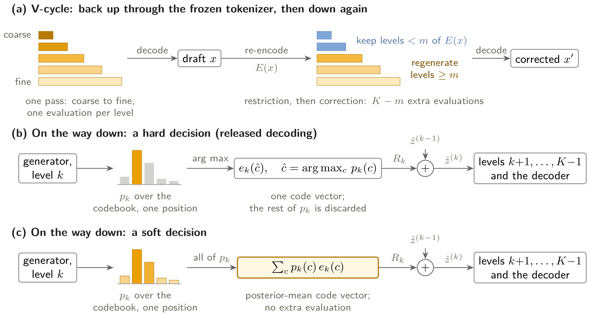
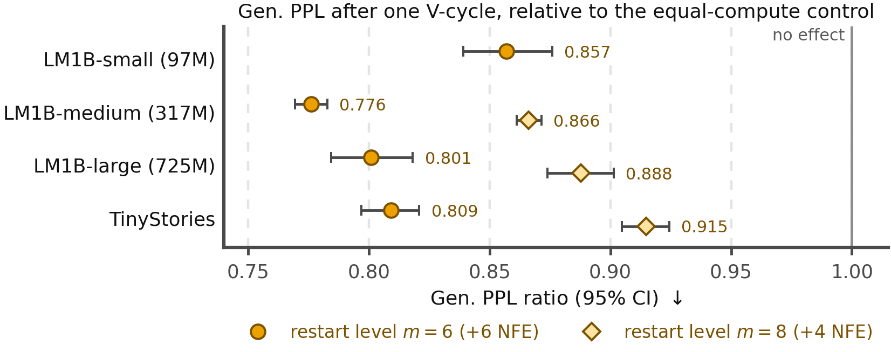
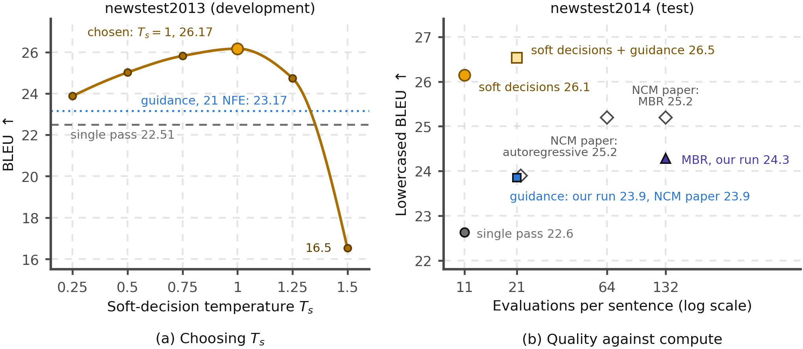
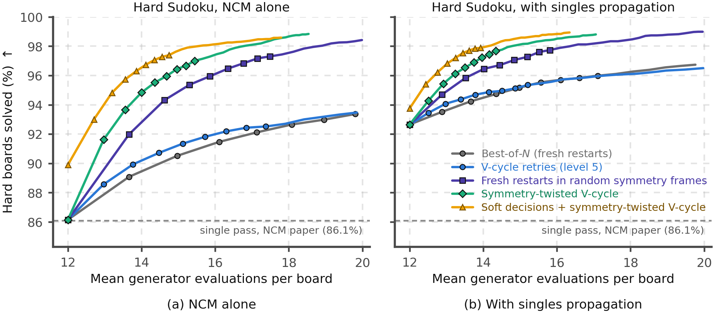

<h1 align="center">A Song of Coarse and Fine</h1>

<p align="center"><strong>V-Cycles and Soft Decisions for Next-Concept Models</strong></p>

<p align="center">
  <a href="paper/main.pdf"></a>
  <a href="https://arxiv.org/abs/2610.14162"></a>
  <a href="https://github.com/HazyResearch/ncm"></a>
  <a href="LICENSE"></a>
</p>

Code, result files and paper for *A Song of Coarse and Fine: V-Cycles and Soft Decisions for Next-Concept Models*
(Tomás Rodrigues, maqia). The paper is in [`paper/main.pdf`](paper/main.pdf).

[Next-Concept Modeling](https://arxiv.org/abs/2610.14162) (NCM) generates text coarse to fine. At each level it
predicts a distribution over discrete codes, keeps one code per position, conditions the next level on that choice
alone, and never looks back. That pass is the downward half of a multigrid V-cycle. This repository studies the
whole cycle, with one change for each direction. Both are training-free: the released NCM checkpoints are used
unchanged, and there is no training code here.

<p align="center">
  
</p>

## Highlights

### V-cycles: the way back up

A finished draft is re-encoded with the frozen tokenizer, the re-encoded coarse levels are kept, and the fine levels are generated again. One cycle from level `m` costs `K - m` more generator evaluations. On unconditional text, one cycle lowers generative perplexity by 14–22% against a control of equal
compute, on every released LM1B model and on TinyStories.

<p align="center">
  
</p>

### Soft decisions: the way down

Each level passes on the posterior-mean code vector, the probability-weighted average of its codebook, instead of the vector of the chosen code. The number of generator evaluations stays the same. On WMT14 German→English this raises BLEU from 21.73 to 25.21.

<p align="center">
  
</p>

### The full cycle on hard Sudoku

With a rule checker that never sees the solution and a new symmetry frame for every retry, the two changes together
solve 96.5% of the hard boards at a mean of 14 generator evaluations per board, against 86.15% in one pass of 12.

<p align="center">
  
</p>

## Installation

```bash
git clone https://github.com/maqiaai-lab/ncm-vcycles.git
cd ncm-vcycles
./setup.sh        # NCM code at the pinned commit, checkpoints and data at pinned revisions, Python packages
```

`./setup.sh sudoku wmt14` fetches only the named tasks (`sudoku`, `wmt14`, `xsum`, `lm1b`, `tinystories`).

The experiments ran on Python 3.12 with PyTorch 2.11 (CUDA 12.8); every pinned version is in
[`PINNED_INPUTS.md`](PINNED_INPUTS.md).

## Usage

Both changes are arguments of one decoder, `LevelDecoder` in [`vcycle/decoding.py`](vcycle/decoding.py), which decodes a
released NCM checkpoint level by level:

```python
from vcycle.loading import load
from vcycle.decoding import LevelDecoder

ncm = load("artifacts/wmt14", device="cuda")                       # a released NCM checkpoint, unchanged
dec = LevelDecoder(ncm)
coarse = dec.encode(tokens)                                        # V-cycle: re-encode the draft,
codes, z = dec.run(prefix, start=m, codes=coarse)                  # keep its levels < m, regenerate levels m..K-1

codes, z = dec.run(prefix, soft={k: 1.0 for k in range(dec.K)})   # soft decisions at every level, T_s = 1
```

The scripts in [`experiments/`](experiments/) are complete runs for every task.

## Results

Every number below is on the released NCM checkpoints and is regenerated in
[`results/SUMMARY.md`](results/SUMMARY.md). Intervals are 95% paired bootstrap intervals.

### V-cycles on unconditional text

Generative perplexity under GPT-2 large, 256 samples per seed. One cycle from level 6 costs 6 more generator
evaluations (and one pass of the frozen encoder, which is not counted). The control regenerates the same levels from the
generated coarse codes, not the re-encoded ones, at the same cost, so it isolates the re-encoding step.

| Model | Seeds | Single pass | Control | One V-cycle from level 6 | V-cycle / control [95% CI] |
|---|---|---|---|---|---|
| LM1B-small | 3 | 93.8 | 93.2 | **79.9** | 0.857 [0.839, 0.876] |
| LM1B-medium | 20 | 88.8 | 88.4 | **68.6** | 0.776 [0.769, 0.783] |
| LM1B-large | 3 | 82.2 | 79.8 | **63.9** | 0.801 [0.784, 0.818] |
| TinyStories | 3 | 16.4 | 16.5 | **13.3** | 0.809 [0.797, 0.821] |

On LM1B-medium a scorer from another family (Qwen2.5-1.5B) gives a ratio of 0.724 [0.717, 0.730], MAUVE rises from 0.307
(control) to 0.410, and an LLM judge prefers the V-cycle sample to the control on 64% of pairs. The cycle costs some
diversity: corpus distinct-2 falls by a few percent (5.6% on LM1B-medium, mean over 20 seeds). Sampling colder also
lowers perplexity for free, so it is the baseline to beat: on LM1B-small (seed 42) a temperature of 0.9 gives 82.5 at a
corpus distinct-2 of 0.464, and one V-cycle gives 79.9 at 0.477.

A second run on other hardware (3 seeds × 256 samples per model) repeats the gain over the control and compares every
decoder with the temperature curve at the decoder's own corpus distinct-2 (below 1 is better than lowering the
temperature):

| Model | V-cycle / control | V-cycle vs temperature curve | Soft decisions at levels 6+ vs curve | V-cycle with soft regeneration vs curve |
|---|---|---|---|---|
| LM1B-small | 0.840 [0.820, 0.861] | 0.915 [0.892, 0.932] | 0.940 [0.915, 0.971] | **0.775 [0.750, 0.794]** |
| LM1B-medium | 0.784 [0.766, 0.801] | 0.875 [0.851, 0.888] | 1.085 [1.059, 1.124] | **0.810 [0.787, 0.821]** |
| LM1B-large | 0.789 [0.772, 0.807] | 0.872 [0.847, 0.888] | 1.047 [1.022, 1.084] | **0.811 [0.786, 0.822]** |
| TinyStories | 0.814 [0.803, 0.825] | 0.916 [0.886, 0.931] | 0.943 [0.925, 0.973] | **0.905 [0.878, 0.920]** |

A cycle from level 6 runs 6 of 11 evaluations but 520 of the 640 code positions of a pass (81%). Under sampling, soft
decisions at the coarse levels, or at every level, ruin the text (5 to 32 times the perplexity of the single pass with
soft coarse levels); at the fine levels alone they act like a lower temperature.

### V-cycles on the prompted tasks

Small. The best of the restart levels and cycle counts tried, read on the test set itself, is +0.55 BLEU [+0.25, +0.83]
on WMT14 (three cycles from level 3) and +0.25 ROUGE-2 [+0.19, +0.31] on XSum (three cycles from level 5). Soft decisions,
below, are the stronger lever there. The output is re-encoded in canonical form (the text, the end token, padding);
re-encoding the raw decoded sequence instead costs −4.28 BLEU [−4.77, −3.81] on WMT14.
The WMT14 gain is partly selection: on newstest2013 the same setting gains +0.26 BLEU [−0.05, +0.57].

### Soft decisions

Greedy decoding. Settings were chosen on data that the reported differences do not use.

| Task | Released single pass | Soft decisions | Difference [95% CI] | Extra evaluations |
|---|---|---|---|---|
| WMT14 German→English, newstest2014, BLEU | 21.73 | **25.21** | +3.48 [+3.06, +3.84] | 0 |
| WMT14, COMET (`wmt22-comet-da`) | 70.47 | **74.15** | +3.69 [+3.34, +4.02] | 0 |
| XSum, ROUGE-1 / 2 / L | 34.92 / 12.71 / 27.93 | **35.87 / 13.52 / 29.01** | ROUGE-2 +0.84 [+0.64, +1.02] on 5,334 held-out articles | 0 |
| Sudoku (hard), boards solved in one pass | 86.15% | **89.90%** | +3.80 points [+2.40, +5.00] on held-out boards | 0 |

With classifier-free guidance on top (21 evaluations instead of 11), WMT14 reaches 25.52 BLEU and 75.38 COMET. Guidance
alone gives 22.96 BLEU.

Our own minimum-Bayes-risk run on WMT14 (12 sampled candidates, 132 evaluations; temperature and similarity chosen on
newstest2013) reaches 23.44 BLEU, +1.72 [+1.35, +2.08] over the single pass and −1.77 [−2.13, −1.40] against one soft
pass. The NCM paper reports 25.2 for its minimum-Bayes-risk decoding without stating the recipe; we could not match
it. Selecting among candidates decoded with soft decisions reaches 24.58, still −0.63 [−1.00, −0.28] against the
single soft pass.

### Both changes on translation and summarization

On WMT14 a V-cycle after the soft pass adds nothing (+0.17 BLEU [−0.05, +0.42] on newstest2014, slightly negative on
newstest2013). Keeping the soft pass's own chosen codes at the coarse levels instead of re-encoding loses 1.1 to 1.6
BLEU, so re-encoding is the way to harden a soft plan without losing it. On XSum one cycle from level 5 after the soft
pass adds +0.21 ROUGE-2 [+0.13, +0.30] on the held-out articles and lowers the perplexity of the summaries from 82 to
61.

### The full cycle on hard Sudoku

Boards solved (%) at a mean budget of 13 / 14 / 16 generator evaluations per board (one pass is 12), 3 seeds × 2,000
boards, NCM alone. A rule checker that never sees the solution (a valid grid that keeps every clue) decides which boards
are retried.

| Method | 13 / 14 / 16 evaluations |
|---|---|
| Best-of-N (fresh restarts, T = 1) | 87.9 / 89.5 / 91.4 |
| V-cycle retries from level 5 | 88.6 / 90.2 / 92.0 |
| Fresh greedy restarts in random symmetry frames | 89.7 / 92.8 / 96.1 |
| Symmetry-twisted V-cycle (a new frame for every cycle) | 91.7 / 94.8 / 97.4 |
| **Soft decisions + symmetry-twisted V-cycle** | **94.1 / 96.5 / 98.2** |

What carries this gain, and what does not:

- **Most of the gain is not re-encoding.** It comes from a new symmetry frame for every retry (random-frame restarts
  against best-of-N: +2.73 [+1.86, +3.50]) and from soft decisions (+1.65 [+0.69, +2.58] on top of the twisted
  V-cycle); both differences are at 14 evaluations on the held-out boards 1,000–1,999.
- **Re-encoding adds little on Sudoku.** In a fixed frame, a V-cycle from level 5 is within noise of its control
  without re-encoding (+0.27 points [−0.20, +0.71] at 14 evaluations, all boards; from level 7 it is ahead, +0.67
  [+0.20, +1.21]). In a new frame, keeping the re-encoded coarse levels adds +1.25 [+0.34, +2.09] over a fresh restart
  at equal evaluations (held-out boards).
- **Counting matters.** A retry from level 5 processes most of the code positions while counting as 7 of 12
  evaluations. At matched FLOPs (1.2 full passes), V-cycle retries are slightly below best-of-N (−0.50 [−1.04, −0.02])
  and the twisted V-cycle ties random-frame restarts (−0.38 [−0.91, +0.07]): there, re-encoding adds nothing.
- **The frames and the checker are specific to Sudoku.** The retries use Sudoku's exact symmetry group and an exact
  rule checker; free text has neither. Singles propagation, a hand-written Sudoku rule, is reported separately (the
  result files without `_nosingles`).
- **Selection.** The retry settings (restart level 5, the budgets) were not chosen on separate data. The soft-decision
  temperature was chosen on boards 0–999, which is why differences are also reported on boards 1,000–1,999.

Without the solution, the level-local round-trip residual detects wrong hard boards with an AUROC of 0.92 (plain
round-trip residual 0.86, decoder confidence 0.87).

## Reproduction

Soft decisions and the diagnosis (one GPU; on an NVIDIA A10G one WMT14 pass over 3,003 sentences takes about a minute):

```bash
python experiments/cond_vcycle.py --task wmt14 --levels 3,5,7 --cycles 3   # the released single pass (cached) and V-cycles
python experiments/cond_vcycle.py --task xsum --levels 3,5 --cycles 3
python experiments/cond_guide_soft.py --task wmt14           # first run: temperatures, level subsets, guidance bands
python experiments/cond_guide_soft.py --task xsum --n 6000
python experiments/cond_soft_confirm.py --task wmt14         # T_s chosen on newstest2013, run once on newstest2014
python experiments/cond_soft_confirm.py --task xsum          # the 5,334 XSum articles not used above
python experiments/comet_score.py                            # own environment: pip install unbabel-comet "setuptools<80"
python experiments/judge.py --task wmt14 --cache cond_soft_confirm_wmt14 --a "soft Ts=1" --b "single pass"
python experiments/judge.py --task wmt14 --cache cond_soft_confirm_wmt14 --a "soft Ts=1" --b "cfg ramp s=1"
python experiments/judge.py --task xsum --cache cond_soft_confirm_xsum --a "soft Ts=0.5" --b "single pass" --n 2000
python experiments/soft_ablations.py --stage tune            # then --stage confirm and --stage confirm --dev
python experiments/oracle_ceiling.py --task wmt14            # tokenizer ceiling; also --task xsum --n 3000
python experiments/oracle_plans.py --task wmt14 --plans gold,self,ext --ext marian=Helsinki-NLP/opus-mt-de-en:4,fsmt=facebook/wmt19-de-en:5
python experiments/oracle_plans.py --task wmt14 --dev --plans ext --ext marian=Helsinki-NLP/opus-mt-de-en:4,fsmt=facebook/wmt19-de-en:5
python experiments/oracle_plans.py --task xsum --n 3000 --bs 16 --plans gold,self,ext --ext bart=facebook/bart-large-xsum:0
python experiments/plan_scores.py --task wmt14               # also --dev and --task xsum --n 3000 --bs 16
python experiments/oracle_report.py
python experiments/comet_oracle.py                           # in the COMET environment
```

V-cycles on unconditional text:

```bash
experiments/run_lm1b.sh small "42 0 1" "3,6"                 # single pass, V-cycle and control, one seed at a time
experiments/run_lm1b.sh medium "42 0 1" "6,8"                # also large; the 20 medium seeds are 42 and 0..18
python experiments/lm1b_diagnostic.py --task tinystories --n 256 --seed 42 --vcycle 6,8   # also seeds 0 and 1
python experiments/lm1b_sweep.py --size small --seed 42      # restart levels, repeated cycles, lower temperatures
python experiments/lm1b_converge.py --size medium --seed 42 --cycles 6:6,8:6               # iterated V-cycles
python experiments/lm1b_quality.py --size medium --no_mauve --variants "baseline,vcycle|m=6,no-restrict|m=6,vcycle|m=8,no-restrict|m=8"
python experiments/lm1b_mauve.py --size medium --boot 20 --variants "baseline,vcycle|m=6,no-restrict|m=6"
python experiments/judge.py --task lm1b --size medium --a "vcycle|m=6" --b "no-restrict|m=6"   # needs a GPU with >= 16 GB
python experiments/judge.py --task lm1b --size medium --a "vcycle|m=6" --b baseline            # also --a human --b baseline
python experiments/judge.py --task wmt14 --a "vcycle|m=5|c=1" --b baseline                     # also --task xsum ... --n 2000
python experiments/ed_sweep.py --stage 1 && python experiments/ed_sweep.py --stage 2           # error diffusion (negative)
```

The second run (both changes combined, temperature curves, minimum Bayes risk; about 25 minutes on four GPUs):

```bash
python experiments/lm1b_frontier.py --size small --seeds 0,1,42      # also --size medium, --size large, --task tinystories
python experiments/cond_cycle_soft.py --task wmt14 --dev             # newstest2013; without --dev: newstest2014
python experiments/cond_cycle_soft.py --task xsum --levels 3 --tag _m3   # and --levels 5 --tag _m5
python experiments/cond_mbr.py --task wmt14 --dev --k 12 --workers 32    # then without --dev
```

Sudoku:

```bash
experiments/run_sudoku.sh                                    # phases 0, 1, 1b, 2 and 3, one job at a time
python experiments/sudoku_stack.py                           # one pass with soft decisions, then retries (hard boards)
SINGLES=0 python experiments/sudoku_stack.py                 # NCM alone: no singles propagation; DIFF=medium|easy for the others
```

Tables and figures:

```bash
python experiments/analyze.py                                # results/SUMMARY.md and results/summary.json
python experiments/figures.py                                # exploratory figures: figures/*.png and figures/*.pdf
for f in paper/scripts/fig_*.py; do python "$f"; done        # figures of the paper
```

The figure scripts need only the files in `results/`. `experiments/analyze.py` needs no GPU and no generator
checkpoint, but it prints sample texts, so it needs the NCM code and the TinyStories tokenizer (`./setup.sh tinystories`)
and downloads the `bert-base-uncased` tokenizer on first use.

**What is pinned.** The NCM code commit, the Hugging Face revisions of the checkpoints and datasets, the revisions of
every tokenizer and evaluation model, and the full Python environment: see [`PINNED_INPUTS.md`](PINNED_INPUTS.md).

**What to expect.** Greedy decoding is deterministic for a fixed machine and batch size, and sampling is seeded.
Across hardware the outputs are not identical token for token: sampling uses a different random stream on another
device, and many greedy decisions are near-ties. Two measurements with this decoder: a CPU rerun of the released single
pass on the first 32 newstest2014 sentences gives the codes of the original GPU run for 27 sentences, and the other five
differ from one code each, where the two codes are within 0.003 in logits; a CPU rerun of the one-pass Sudoku experiment
on the first 250 hard boards agrees with the original GPU run on 1,248 of 1,250 board outcomes. In the original runs on
a GPU, the cached-prompt Sudoku decoder differed from `generate()` on 1 of 2,000 boards at a near-tie, so the exact
assertion in `experiments/phase0_baseline.py` can fail there; the uncached decoder matched on all 2,000. The confidence
intervals are seeded.

**Checks made on this tree.**

- `python experiments/analyze.py` rebuilds `results/SUMMARY.md` from the files in `results/`: the tables of the
  original runs come back character for character, followed by five sections added for this release (variants of soft
  decisions, the one-pass Sudoku table, the tokenizer ceiling, plan swaps, plan scores).
- Every Python file compiles, and none contains training code.
- Every file in `results/`, apart from `README.md`, `SUMMARY.md` and `summary.json`, is the file of the research
  repository, unedited.

**How this code relates to the runs.** This is the research code at the commit that produced the result files.
Two things differ: `setup.sh` pins the Hugging Face revisions and fetches every task, and `experiments/analyze.py` has
the five sections named above appended, which read the same result files. The run logs and the scripts used to drive a
rented machine are not included. The three scripts of the second run and their result files (`lm1b_frontier_*`,
`cond_cycle_soft_*`, `cond_mbr_*`) were added after the research repository's last commit; that run was made on one NVIDIA GH200
node, and its per-sample caches (350 MB) are not in the repository.

**What is not here.** No training code, and no model trained for this work: every experiment runs the checkpoints of
the public NCM release.

## Repository layout

| Path | Contents |
|---|---|
| `vcycle/decoding.py` | `LevelDecoder`: level-by-level decoding of a released NCM checkpoint, equivalent to `generate()`; soft decisions (`run(soft=...)`), classifier-free guidance, levels given from outside (`run(start=, codes=)`), cached prompts, encoding (`encode`, `encode_given_coarse`) and decoding |
| `vcycle/vcycle.py` | the V-cycle of the Sudoku phases: restart-level rules, masked resampling, constraint projection, iterated cycles |
| `vcycle/sudoku.py`, `vcycle/lm1b.py`, `vcycle/cond.py` | task code: Sudoku format, constraint checks and metrics; unconditional text sampling, scoring and diversity; prompted tasks (XSum, WMT14) and their metrics |
| `vcycle/loading.py`, `vcycle/common.py`, `vcycle/cache.py`, `vcycle/devsets.py`, `vcycle/plotstyle.py` | loading a released checkpoint; paths; cached single passes; newstest2013 (fetched with sacrebleu); figure style |
| `experiments/cond_guide_soft.py` | soft decisions, first run: by temperature and level subset, guidance by band; tuning and report halves |
| `experiments/cond_soft_confirm.py`, `experiments/comet_score.py` | soft decisions: settings chosen on newstest2013, then newstest2014; the XSum articles not used before; COMET |
| `experiments/soft_ablations.py` | variants of soft decisions: nearest code to the mean, confidence gating, top-k blending |
| `experiments/oracle_ceiling.py`, `experiments/oracle_plans.py`, `experiments/plan_scores.py`, `experiments/oracle_report.py`, `experiments/comet_oracle.py` | the diagnosis: tokenizer ceiling, plan swaps, search error against model error |
| `experiments/lm1b_diagnostic.py` (driver: `experiments/run_lm1b.sh`) | unconditional text (LM1B, TinyStories): the single pass, one V-cycle per restart level and its equal-compute control; round-trip residuals |
| `experiments/lm1b_sweep.py`, `experiments/lm1b_converge.py` | restart levels, repeated cycles, lower temperatures; iterated V-cycles |
| `experiments/lm1b_quality.py`, `experiments/lm1b_mauve.py` | LM1B-medium beyond GPT-2 perplexity: human anchor, a second scorer, MAUVE with paired subsampling |
| `experiments/cond_vcycle.py` | prompted tasks: the released single pass (cached for the other scripts) and V-cycles |
| `experiments/lm1b_frontier.py` | second run, unconditional text: temperature curve, soft decisions under sampling, V-cycle with soft regeneration, cost in code positions |
| `experiments/cond_cycle_soft.py` | second run, prompted tasks: V-cycles after a soft pass, with their controls |
| `experiments/cond_mbr.py` | second run, WMT14: minimum-Bayes-risk decoding over sampled candidates, with and without soft decisions |
| `experiments/phase0_baseline.py`, `phase1_fixed_point.py`, `phase1b_localization.py`, `phase2_vcycle.py`, `phase3_controls.py` (driver: `experiments/run_sudoku.sh`) | Sudoku: reproduction of the released pass; the round-trip residual as an error detector and where it points; greedy V-cycles; checker-gated retries at matched compute |
| `experiments/sudoku_stack.py` | Sudoku: one pass with soft decisions; retries with symmetry frames, soft decisions and singles propagation |
| `experiments/ed_sweep.py` | error diffusion within a level (a negative result) |
| `experiments/judge.py` | pairwise LLM judge (local model; no text leaves the machine) |
| `experiments/check_gpu_scoring.py`, `experiments/check_prefix_cache.py` | checks of a new machine against the stored samples, and of the cached-prompt path against `generate()` |
| `experiments/analyze.py`, `experiments/figures.py` | rebuild `results/SUMMARY.md` and `results/summary.json`; draw the exploratory figures in `figures/` |
| `results/` | raw results (`*.json`), per-sample caches (`cache/`) and the generated `SUMMARY.md`: see [`results/README.md`](results/README.md) |
| `paper/` | LaTeX source, figures and the scripts that draw them from `results/` |
| `assets/` | the images of this page, made from the paper |

## Citation

```bibtex
@misc{rodrigues2026vcycles,
  title  = {A Song of Coarse and Fine: V-Cycles and Soft Decisions for Next-Concept Models},
  author = {Rodrigues, Tom{\'a}s},
  year   = {2026},
  note   = {maqia}
}
```

Released under the [MIT license](LICENSE). The NCM code, checkpoints and datasets, and
the evaluation models, keep their own terms: see [`THIRD_PARTY_NOTICES.md`](THIRD_PARTY_NOTICES.md).
